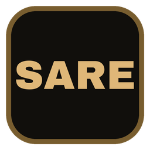

# SARE - San Andreas Rust Edition

Current development version: **0.35.0**. The base version 0.33.0 was set from the
33 published GitHub releases visible on 17 October 2026, including the first
release. Small bugfix releases increment the last number: `0.33.1`, `0.33.2`,
`0.33.3`, and so on. Larger feature updates increment the middle number and reset
the patch number: `0.34.0`, `0.35.0`, and so on. Version numbers are assigned per
release, not per commit. This is not a percentage complete.
The shared version lives in
`native/Cargo.toml` under `[workspace.package]`; the launcher also shows the Git
build ID to distinguish builds. Existing commit-based release tags stay valid.

> **💬 Join the community on Discord: <https://discord.gg/F8KwXJqw6D>**
> Get help, report bugs, find people to play with and follow development.

> **Legal:** SARE is an unofficial fan project. It is not affiliated with,
> endorsed or sponsored by Rockstar Games or Take-Two Interactive. You need
> your own legally purchased copy of the PC game; SARE ships no game files.
> See [Legal](#legal).

## Native interface refresh

Launcher, title screen, pause menus and HUD now share SARE styling, with a warm
accent, original vector artwork, readable focus states and compact gameplay
status. See [design, native previews and validation](docs/native-ui-refresh.md).

## Native launcher (local review build)

Build developers: `cargo build --release --workspace --manifest-path native/Cargo.toml`.
Run **start-sare.cmd**, or **native/target/release/sa-launcher.exe**. Packaged users
run `sa-launcher.exe` (Linux: `./sa-launcher`); Cargo is not needed. Select and
validate your original PC installation, then Play / Continue or join through
Play together. Direct runtime startup remains supported.

The launcher shares settings and launch contracts with the runtime, saves favorites,
shows installation errors, previews unused cache cleanup and creates reviewable
local diagnostic reports. Runtime joins prepare and verify server resources before
automatically entering gameplay. All multiplayer binaries now need **protocol 8**;
round-trip time is measured on the gameplay connection. F3 shows frame/CPU timings
and resident memory. GPU timestamp profiling is not implemented.

See [launcher setup and limits](docs/launcher.md) and [package instructions](docs/client-package.md).
Every successful main-branch CI build publishes Windows/Linux and separate
Apple Silicon/Intel macOS client ZIPs. Packaged
launchers automatically download tested updates and restart after the game closes.
Source checkouts continue to use Git/Cargo. See [automatic updates](docs/client-updates.md).

## Latest free-roam build — October 8, 2026

Run **start-sare.cmd**, then choose **Play** to enter free roam in walk mode
and streams nearby neighborhoods as you move. Use **1–9** to travel to Grove
Street, downtown Los Santos, the beach, the airport, the countryside, San
Fierro, Las Venturas, the desert, and Mount Chiliad. Press **P** to toggle
free-fly mode and **R** to return to Grove Street.

Missions are not currently a priority. The Rust runtime supports native mods
with custom DFF models, TXD/PNG textures, COL collision, map placements, and
selected vehicle and player resources. See [free-roam status](docs/freeroam-status.md)
and [native mod documentation](docs/native-mods.md) for current controls,
capabilities, and compatibility details.

## Player-hosted multiplayer

Open **Multiplayer**, press **F5**, or use **/mp** to host/join a session with
up to **20 players including the host**. Player and driving poses synchronize;
selected cars, peds and clothing synchronize from the shared resource catalog. Direct IP/LAN
connections are supported; direct internet hosting requires TCP port forwarding.
The new relay mode adds a **server browser and join codes**, with outbound
connections from host and guests. Run `start-relay.cmd` on a reachable trusted
LAN/VPN machine, then configure its address in Multiplayer. The game host
needs no port forwarding in relay mode. No public relay or Steam integration
is configured; the prototype relay uses unencrypted TCP.
For a server that stays running without a player's game, download
**SARE-server-windows.zip** or **SARE-server-linux.zip** from the
[latest release](https://github.com/LordM8YT/GTA-San-Andreas-Rust-Edition/releases/latest)
and run **start-server.cmd**, or run it from a source checkout.
The headless server is set up like a FiveM server: `server-data/server.cfg`,
`resources/[category]/` with `fxmanifest.lua`, server-side Lua (events,
commands, exports, threads), sandboxed client Lua with menus and dialogs drawn
by the game ([client scripts](docs/client-scripts.md)), ACL and rcon. The first start asks for a template: Freeroam, or
[SARE Box](docs/sarebox.md), a small roleplay framework with saved characters,
signed player licenses, money, jobs, a taxi job and an admin menu (SARE's own
framework, not Qbox). Players chat with **T** and use the
**F8** console. See [server setup](docs/server-hosting.md). Frameworks get
`@resource` includes, `provide`, function references, server-side state bags
and CfxLua syntax; ox_lib starts on the server, Qbox is not supported yet. See
[framework compatibility](docs/framework-compatibility.md).
Required native mods download and cache before joining; disconnect restores
your offline world and local mods. Personal cars remain visible after their
owner exits. Hosts also reserve up to three passenger seats so players can
ride together. NPCs, shared vehicle collisions and exchanging cars are not
yet replicated. See [multiplayer setup and limits](docs/multiplayer.md).

Personal cars and passenger rides are implemented; exchanging car ownership and
shared collisions remain planned. See the [roadmap](docs/roadmap.md) for priorities.

## Menus, HUD, and settings

The main and pause menus provide destination selection, controls, wardrobe,
interiors, local-resource status, and settings. HUD options include a custom
radar/minimap and an in-car speedometer. Display, mouse, movement, and vehicle
handling settings are saved under `%LOCALAPPDATA%/SAFreeroam/settings.json`.

Offline free roam now remembers a safe outdoor position, camera, selected car,
ped and clothing every 60 seconds at a safe offline position, when opening a menu,
quitting normally or preparing multiplayer.
The next launch offers **Continue free roam**. Removed models fall back to
current defaults; unsafe locations fall back to Grove Street. Multiplayer
progress remains separate. See [local checkpoints](docs/progress.md).

The radar and overview map use the original `radar00.txd`–`radar143.txd` tiles
from `models/gta3.img` in the selected San Andreas
installation, positioned from the game's world coordinates. It rotates with the
player's heading, supports adjustable zoom, and overlays the runtime's travel
markers. If the original radar texture dictionary is unavailable, the runtime
does not substitute a fabricated map. The local-resource menu
lists detected enabled and disabled resources; edit `enabled` in each `resource.json` or `mod.json`
and restart to change their state.

Original menu cues, basic spatial engine loops and local grounded footsteps
now load directly from the installation. Nearby multiplayer cars emit engine
sound too. Surface-specific steps, collision sounds and original radio
archives are still pending; see
[native audio](docs/native-audio.md). Press **I** to visit the three available
interiors and **R** or a map destination to return outside.

## Mod compatibility

The native runtime loads documented `resource.json` / `mod.json` resources and supported assets;
it is not a drop-in loader for arbitrary original San Andreas mods. Existing
binary plugins, scripts, IDE/ IPL/IMG workflows, and mods that depend on the
game executable or its plugin APIs are not expected to work without conversion
or dedicated support. Read [native mod documentation](docs/native-mods.md)
before preparing a resource. An experimental [GTA V / FiveM asset converter](docs/gta5-conversion.md)
can prepare Legacy cars, props and explicitly mapped clothing as native resources.
The new folder importer can inspect FiveM packages and batch-convert their cars
or props, and preserve static placements from Legacy YMAP or CodeWalker XML. Unsupported
scripts and metadata are listed in the import report. See
[FiveM conversion](docs/gta5-conversion.md#import-a-resource-folder).

Graphics settings now include FSR 1 EASU/RCAS, FXAA, render scale, image controls,
quality presets, renderer selection and frame limits. See [graphics](docs/graphics.md).
Vulkan is available on Windows; Linux startup and CI build checks are included,
with Linux gameplay validation still pending: [Linux](docs/linux.md).
DLSS and temporal FSR are not integrated yet.

An offline [texture-upscaling tool](docs/texture-upscaling.md) produces optional
native PNG overrides. Generated textures stay local; original game files are
not modified or included in this repository.

## Legal

**Purpose.** SARE is an alternative engine for playing and modding your own
copy of San Andreas, with native mod support, multiplayer and modern graphics.
It is not a replacement for the game and does not recreate it: without the
original PC files it has no world, characters, vehicles or sound, and it does
not include the story, missions or cutscenes.

SARE is an independent, non-commercial fan project. It is not affiliated with,
endorsed or sponsored by Rockstar Games, Take-Two Interactive or Cfx.re.
Grand Theft Auto, San Andreas and related names and logos are trademarks of
their respective owners and are used here only to describe compatibility.

- **No game content.** This repository and its releases contain no Rockstar
  files: no models, textures, maps, audio, text or executables. SARE reads
  them at runtime from the player's own legally purchased PC installation.
  Converted, extracted or upscaled copies of original files must stay on your
  own computer and must not be uploaded to this repository, releases or
  servers.
- **Original code.** The engine is written from scratch in Rust. It is not
  based on, translated from or derived from the game's executable or from
  decompiled or disassembled code (for example re3, reVC or gta-reversed).
  See the clean-room rules in [AGENTS.md](AGENTS.md#clean-room-rules).
- **Free.** SARE is free under the MIT license. The project accepts no
  payments, donations or sponsorships, and nothing is sold.
- **Third-party assets.** Only convert models you made yourself or have
  permission to use. Do not convert content from GTA V or other Rockstar
  games.

Rights holders with a concern can open an issue or contact the maintainer on
[Discord](https://discord.gg/F8KwXJqw6D), and we will respond quickly.
