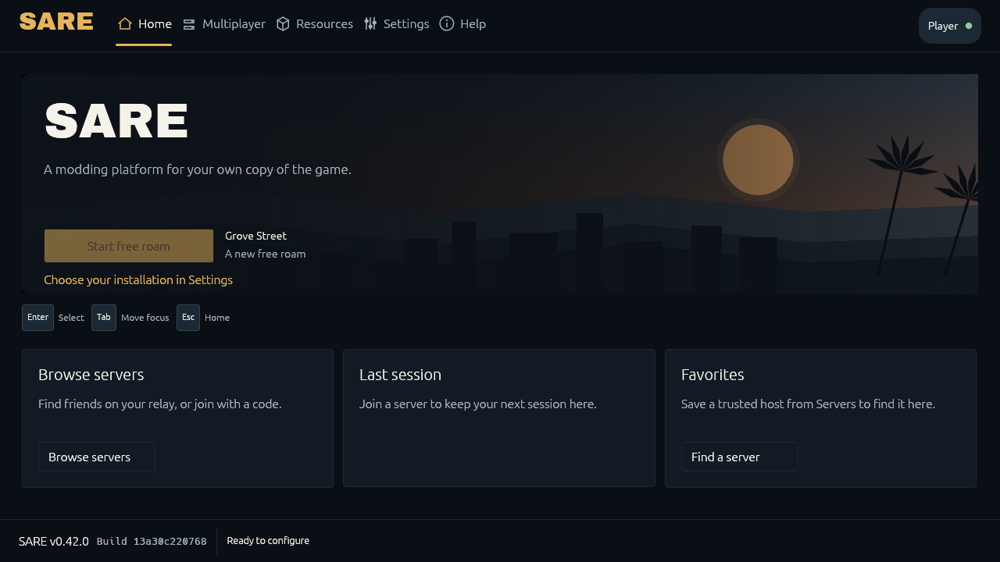
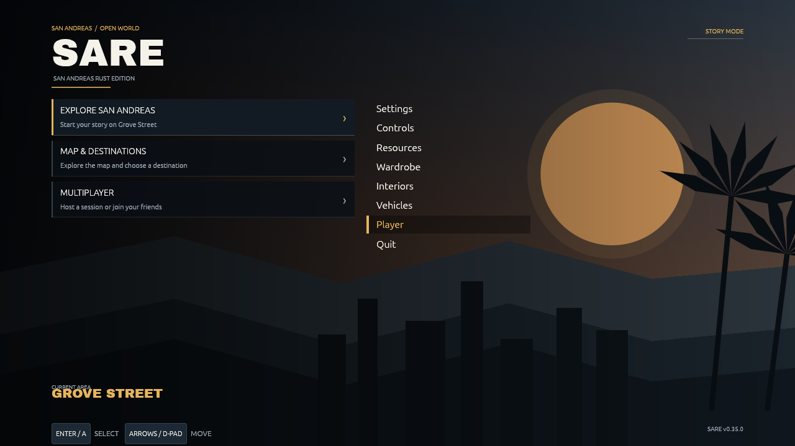
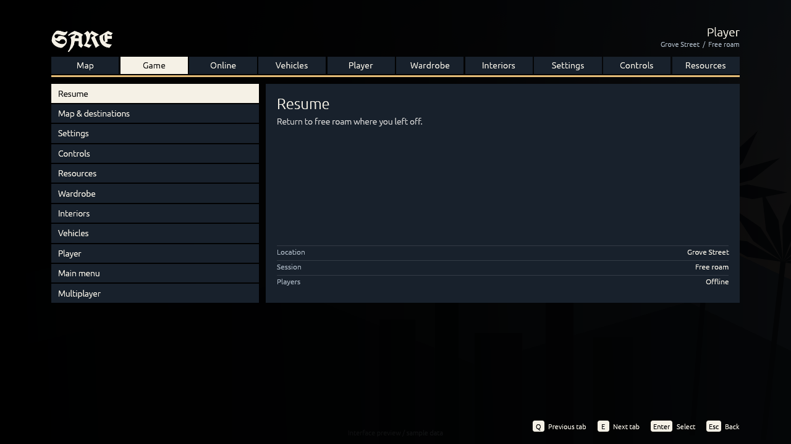
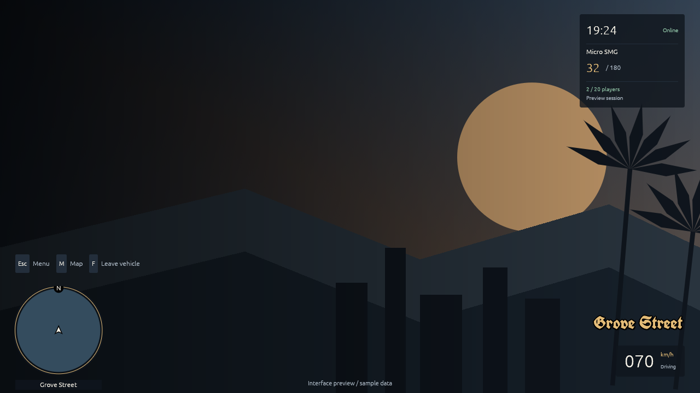

# SARE 0.34.0: native interface refresh

The launcher, title screen, pause menus and gameplay HUD share a native egui
design. The layout takes its cues from San Andreas lettering and GTA's clear
menu selections, with SARE's own palette and original vector artwork.

Contributor guidance and the required visual/technical review gate are documented in the [UI design system guide](ui-design-system.md). The current implementation remains a foundation until visual sign-off is complete.

## Design direction

| Token | Color | Role |
| --- | --- | --- |
| Background | `#0F151D` | Quiet blue-black base |
| Surface | `#18212C` | Controls and menu panels |
| Raised surface | `#232E3B` | Hover and secondary controls |
| Text | `#F5F1E6` | Warm white for readable text |
| Accent | `#E4BC77` | Selection and primary actions |
| Status | `#8FC2A5` | Online status |

The existing OFL UnifrakturCook font carries the SARE wordmark. Body text uses
egui's bundled proportional font. The title screen puts play, map and multiplayer
in a clear left column, with customization on the right. The pause screen keeps
the familiar tab/list structure. Gameplay keeps the circular radar and groups
clock, ammunition and online status in one corner.

The design plan was reviewed before implementation: the generic orange client
palette and oversized dashboard spacing were replaced with a shared palette,
San Andreas lettering and a static sunset/palm silhouette. Decoration stays in
the title/launcher artwork; gameplay gets compact information and fewer hints.
There are no new blur passes, web views, looping UI animations or invented
health/fuel/gear values.

Design guidance: [Anthropic Frontend Design](https://github.com/anthropics/skills/blob/main/skills/frontend-design/SKILL.md).
The skill was read and applied to the native interface; no third-party skill
package or Rockstar artwork is bundled. The existing local PNG artwork option
still overrides the launcher's default background.

## Native previews

These are captures of the actual Rust/egui interface. The in-game preview uses
sample data and an original vector background, without a GTA installation. Its
empty radar is expected because no original map tiles are supplied. The launcher
capture uses an isolated, unconfigured profile, so Play is disabled. These are
local development captures, not published client builds.






## Previewing the actual menu code

Set `SARE_CONFIG_DIR` to a separate, writable review-profile directory. Then run:

```text
cargo run --manifest-path native/Cargo.toml -p sa-launcher --example interface-preview -- main 1280 720 /absolute/path/main.png
```

Supported pages: `main`, `pause`, `hud`, `map`, `settings`. The output must not
already exist. The example shares the production menu, theme and location
definitions. It never launches the game, connects a session or writes game files.

For launcher captures, the existing `SARE_SCREENSHOT_TO`, `SARE_PREVIEW_PAGE` and
`SARE_PREVIEW_SIZE` controls remain available. The screenshot output must be
inside the isolated `SARE_CONFIG_DIR`.

## Validation and limits

Regression tests cover title and pause action bounds at 640×480, 1280×720 and
2560×1080, a working mouse click on Quit, pause-tab label widths, keyboard/controller
navigation, and separation of the status group, zone announcement and speedometer.
Compact settings keep their values clear of the arrow buttons and offer scrollable
setting details. A focused Settings action must not also start or resume free roam. Q/E tab
navigation still works when a button has focus; text entry retains its keys.

The UI still needs Windows/macOS platform CI and gameplay checks over the real
world, with long player names, custom artwork, large HUD scales and server-script
overlays. No original-map performance or 60 FPS claim follows from UI previews.
The original installation, game assets and multiplayer protocol are unchanged.

See the [Ponytail review and verification report](ui-refresh-review.md).
