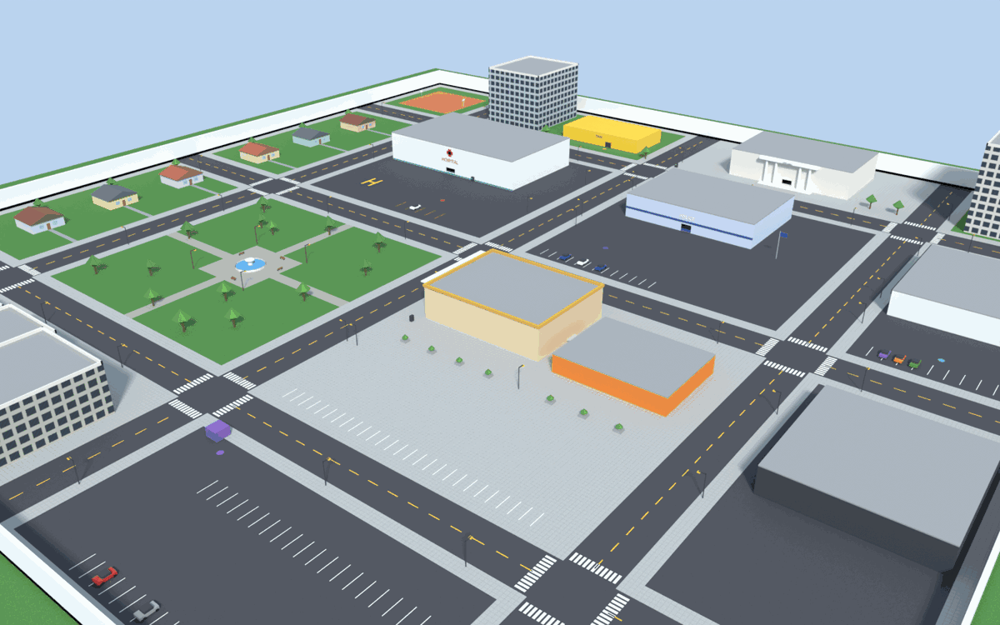

# SARE RP Town

A ready-to-host roleplay server for SARE on its own map. It needs no GTA San
Andreas files: the town is the free **SARE RP Town** content pack
(`content/sare-rp-town`, CC0), built in Blender by
[`tools/blender/make_rp_town.py`](../../../tools/blender/make_rp_town.py).



The scripts are built on [SARE Box](../../../docs/sarebox.md) (`sarebox_core`
for characters, money, jobs and saving; `sarebox_admin` for staff tools).
Everything is server-authoritative: the server checks position, job, duty and
money on every action, and clients only show menus.

## What is in the town

| Place | What you do there |
| --- | --- |
| Legion Square (park, centre-west) | New characters spawn here |
| Police station (north) | Go on duty, armoury, job cars, cells |
| Hospital (north-west) | Check in for treatment, EMS duty, job cars, ATM |
| Bank (centre) | Deposit, withdraw, transfer; ATMs around town |
| 24/7 shop and gas station | Food, drinks, phone, tools |
| City Hall (far north) | Job centre (taxi, mechanic, unemployed), new ID |
| Premium Motors (east) | Buy a car (paid from the bank) |
| Mechanic garage (east) | Mechanic duty |
| Public garage (south) | Store and take out your cars |
| Taxi depot (north-west) | Taxi duty and job car |

Houses, apartments, a warehouse yard, a diner, a clothes shop, a basketball
court and a parking lot fill the rest of the 340 × 340 m map.

## Resources

| Resource | Does |
| --- | --- |
| `sare_rp_core` | Places of the map, blips, the **H** interaction, menus, dialogs, progress bars, helpers (`exports.sare_rp_core:GetRP()`) |
| `sare_rp_identity` | Character name, date of birth and gender on first join; `/identity`, `/showid`; new ID at City Hall |
| `sare_rp_chat` | Local chat and `/me`, `/do`, `/shout`, `/looc`, `/try`; global `/ooc`, `/twt`, `/ad` |
| `sare_rp_bank` | Bank counter and ATMs: deposit, withdraw, transfer by citizen ID or server ID |
| `sare_rp_inventory` | Weight-limited inventory (30 kg), use/give/drop, phone, shops |
| `sare_rp_vehicles` | Car dealer, owned cars with plates, public garage, job vehicles |
| `sare_rp_jobs` | Police, EMS, taxi, mechanic: duty, gear, dispatch (`/911`, `/call`), bills, fines, cuffs, search, jail, treatment |
| `sare_rp_admin` | `/tp`, `/giveitem`, `/clearinventory`, `/dvall`, `/coords` |
| `sare-rp-map` | Spawn points in Legion Square |

Settings (prices, items, shops, job gear, keys, chat ranges, jail time) are in
`sare_rp_core/shared/config.lua`. Map positions are in
`sare_rp_core/shared/locations.lua`, which the Blender script writes.

## Run it on your PC

1. **Create the server.** Run `start-server.cmd` (Windows) or
   `./start-server.sh` (Linux) in an empty server folder and pick
   **SARE RP Town**. Without a console, use
   `sa-server +set sv_template sare-rp`. This writes `server.cfg` and copies
   these resources into `server-data/resources/[sare-rp]/`.
2. **Install the map for every player.** Copy `content/sare-rp-town` from
   this repository into the `content/` folder of each player's SARE (next to
   `mods/`; in a source checkout the repository's own `content/` already has
   it). Servers cannot send content packs yet.
3. **Join.** The launcher only opens content packs offline for now, so join
   from a terminal:

   ```text
   sa-runtime --content sare-rp-town --join 127.0.0.1:7777 --name Anna
   ```

   On another PC use the server's LAN or public address instead of
   `127.0.0.1`.
4. **Make yourself admin.** Type `/id` in game, copy your license and add
   this line to `server.cfg`, then restart:

   ```text
   add_principal identifier.license:<your license> group.admin
   ```

5. **Hire police and EMS.** These jobs are whitelisted. From the server
   console or as admin (F11 or chat):

   ```text
   setjob <server id> police 0
   setjob <server id> ambulance 0
   ```

   Taxi and mechanic are open jobs: players take them at City Hall.

## Host it on a Linux VPS

Any small VPS works (1 vCPU, 1 GB RAM); the server needs no GPU or game
files.

1. Download `SARE-server-linux.zip` from the
   [latest release](https://github.com/LordM8YT/SARE/releases/latest) and
   extract it, for example to `/opt/sare`.
2. Create the RP server without prompts:

   ```bash
   cd /opt/sare
   ./start-server.sh +set sv_template sare-rp
   ```

   Stop it (type `quit`) and edit `server-data/server.cfg`: name, slots,
   `rcon_password`, your admin `add_principal` line.
3. **Open the port.** SARE gameplay uses TCP 7777; rcon uses UDP 7777.

   ```bash
   sudo ufw allow 7777/tcp
   sudo ufw allow 7777/udp
   ```

   Also open the port in your provider's firewall panel if it has one.
4. **Keep it running.** Use `tmux` or `screen`, or a systemd service:

   ```ini
   # /etc/systemd/system/sare.service
   [Unit]
   Description=SARE RP Town
   After=network-online.target

   [Service]
   WorkingDirectory=/opt/sare
   ExecStart=/opt/sare/start-server.sh
   Restart=on-failure
   User=sare

   [Install]
   WantedBy=multi-user.target
   ```

   `sudo systemctl enable --now sare`. The start script installs new SARE
   releases by itself while nobody is online (`set sv_autoUpdate false`
   turns that off).
5. Players join with `sa-runtime --content sare-rp-town --join <vps-ip>:7777`.
6. **Optional relay.** To show up in a SARE server browser or use join codes
   instead of an IP, run `sa-relay` somewhere reachable and set
   `set sv_relay "relay-ip:7778"` (see
   [multiplayer setup](../../../docs/multiplayer.md)).
7. **Back up** `server-data/kvp/` (characters, money, inventories, cars) and
   `server-data/server.key` (the server identity players trust).

## Playing

| Key | Does |
| --- | --- |
| **H** | Use the place in front of you (a hint shows `[H] …`) |
| **K** | Inventory (also `/inventory`, `/inv`) |
| **F2** | Job menu: duty, fines, cuffs, search, jail, treat, bills |
| **F1** | Player menu (SARE Box) |
| **F11** | Admin menu (admins) |
| **F9** | Spawn your own SARE Kart to drive (content packs) |
| **T** | Chat |

Chat and roleplay commands:

| Command | Does |
| --- | --- |
| *(plain text)* | Say it to players within 15 m |
| `/me text`, `/do text` | Action and description, 20 m |
| `/shout text` | 35 m |
| `/looc text` | Local out-of-character |
| `/try action` | Random success or failure, shown nearby |
| `/ooc text` | Global out-of-character |
| `/twt text` | Global "tweet" with your character name |
| `/ad text` | City-wide advert, $50 from the bank |
| `/911 message` | Police and EMS on duty get the call with a map blip |
| `/call taxi\|mechanic\|ems message` | Call a service |
| `/bill <id> <amount> [reason]` | Bill a player (on-duty EMS, mechanic, taxi) |
| `/cuff`, `/search`, `/fine <id> <amount> [reason]`, `/jail <id> <minutes>`, `/unjail <id>` | Police on duty (also in the F2 menu) |
| `/treat <id>` | EMS on duty: uses a medkit or bandage |
| `/identity`, `/showid` | Your ID; show it to people nearby |
| `/id` | Your server ID and license |

Admin commands (`group.admin`): SARE Box's `setjob`, `givemoney`, `goto`,
`bring`, `kick`, `announce`, plus `/tp <x> <y> <z>` or `/tp <place>`,
`/giveitem <id> <item> [count]`, `/clearinventory <id>`, `/dvall` (remove
all server cars) and `/adminunjail <id>`. `/coords` is open to everyone and
prints both world and Blender coordinates, handy when moving places.

## Editing the map in Blender

The map is generated by a script, so you can either change the script or edit
the model by hand.

**Change the script** (best for new buildings or moved places). Install
Blender 4.2 or newer and run from the repository root:

```bash
blender -b --factory-startup --python tools/blender/make_rp_town.py
```

It writes `content/sare-rp-town/world.glb`,
`sare_rp_core/shared/locations.lua` and `sare-rp-map/map.lua`. Useful
options after `--`: `--blend town.blend` (save the scene to edit by hand),
`--render preview.png`, `--map map.png`, `--no-export`. The interaction
points are the `LOCATIONS` table near the top: Blender X is east, Y is north,
in metres, and the map's origin is San Andreas position (2500, -1670).

**Edit by hand.** Open Blender, *File → Import → glTF 2.0*, pick
`content/sare-rp-town/world.glb` (or open the `.blend` from `--blend`).
Model with plain materials and PNG textures, then *File → Export → glTF 2.0
(.glb)* with *+Y Up* on and *Apply Modifiers*. Name rules:

- `COL_…` objects are invisible but solid (walls, simple collision boxes).
- `NOCOL_…` objects are drawn but not solid (signs, plants, wires).
- Everything else is drawn and solid. Alpha Blend materials (glass) are not solid.

When you move a door or counter, stand there in game, type `/coords` and put
the world position into `locations.lua` (the script overwrites that file, so
also update `LOCATIONS` if you use both). Check the pack without a window:

```bash
sa-runtime --probe-standalone --content sare-rp-town
```

See [content packs](../../../docs/content-packs.md) for everything the loader
reads.

## Limits (today)

- Players must install the content pack themselves and join from the
  command line; servers cannot send or require packs yet.
- In a content pack, other players are not drawn yet (their game has no
  ped model to show); chat, money, jobs and menus work. Running with your
  own San Andreas copy instead of the pack shows players but not this town.
- Cars from the dealer, garage and job lockers are server cars: everyone
  sees them parked, but nobody can drive server cars yet. Drive your own
  F9 SARE Kart.
- There is no API to repair or damage cars yet, so the mechanic job is
  dispatch and billing only.
- Characters are tied to the license of the player's SARE install; one
  character per license.
